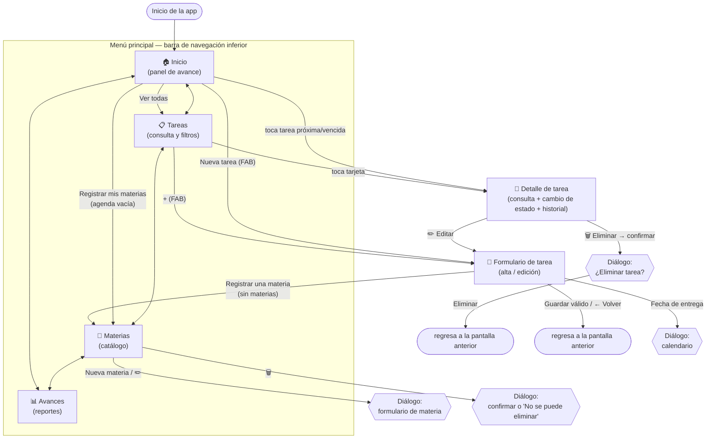

# Entregable 2 — Mapa de navegación

**Aplicación:** Agenda Académica · **Equipo 1**

El diagrama está en Mermaid: se ve como gráfico en GitHub, en VS Code (con la extensión Markdown Preview Mermaid) y en https://mermaid.live, desde donde también se puede exportar a PNG o SVG para el expediente impreso. Coincide exactamente con las rutas del código (`ui/navegacion/Navegacion.kt`).

## 1. Estructura general (arquitectura de información)

## 2. Inventario de pantallas

| # | Pantalla | Tipo | Ruta (código) | Contenido principal |
|---|---|---|---|---|
| P1 | **Inicio** | Pantalla de inicio / panel | `inicio` | Fecha de hoy, avance general (%), contadores (pendientes, en progreso, vencidas), próximas entregas (7 días), vencidas. Si la agenda está vacía: bienvenida con *Registrar mis materias* y *Cargar datos de ejemplo*. |
| P2 | **Tareas** | Consulta | `tareas` | Búsqueda, filtros (estado, prioridad, materia), orden, contador "X de Y tareas", lista de tarjetas con casilla de completar. |
| P3 | **Materias** | Consulta + captura (diálogo) | `materias` | Lista de materias con avance; alta, edición y eliminación. |
| P4 | **Avances** | Reporte | `avances` | Avance general, barras por estado, puntualidad, sin completar por prioridad y avance por materia. |
| P5 | **Detalle de tarea** | Consulta secundaria | `tarea/{tareaId}` | Datos completos, aviso de vencida, cambio de estado, historial; acciones Editar y Eliminar. |
| P6 | **Formulario de tarea** | Formulario de captura | `formulario_tarea?tareaId={tareaId}` | Título, descripción, materia, prioridad, fecha y (en edición) estado. Sin `tareaId` funciona como alta; con `tareaId`, como edición. |
| D1 | Diálogo de materia | Formulario modal | (dentro de P3) | Nombre, profesor, color. |
| D2 | Diálogo de calendario | Selector modal | (dentro de P6) | Calendario con las fechas pasadas deshabilitadas. |
| D3 / D4 | Confirmaciones | Modal | (P3, P5) | ¿Eliminar materia o tarea? |

**Clasificación pedida por el examen:**
- **Pantalla de inicio:** P1.
- **Menú principal:** la barra inferior con P1–P4.
- **Pantallas secundarias:** P5 y P6.
- **Formularios de captura:** P6, D1 y D2.
- **Consultas:** P2, P3 y P5.
- **Reportes:** P4 (y el panel de P1).

## 3. Rutas, acciones y transiciones

| Desde | Acción del usuario | Hacia | Transición / comportamiento |
|---|---|---|---|
| Cualquier P1–P4 | Toca un ítem de la barra inferior | P1–P4 | Cambio de pestaña sin apilar (`launchSingleTop`); conserva el estado de cada pestaña (`saveState`/`restoreState`). Atrás desde una pestaña regresa a Inicio. |
| P1 | FAB *Nueva tarea* | P6 (alta) | Se apila; Atrás regresa a P1. |
| P1 | Toca una tarea próxima o vencida | P5 | Se apila. |
| P1 (vacío) | *Registrar mis materias* | P3 | Cambio de pestaña. |
| P1 (vacío) | *Cargar datos de ejemplo* | P1 | El panel se llena; Snackbar "Datos de ejemplo cargados". |
| P2 | FAB + | P6 (alta) | Se apila. |
| P2 | Toca una tarjeta | P5 | Se apila. |
| P2 | Casilla de la tarjeta | P2 | Alterna Completada/Pendiente; la lista se actualiza sola (Flow de Room). |
| P2 | Chips de filtro / búsqueda / menú Ordenar | P2 | Filtrado inmediato. |
| P5 | ✏️ Editar | P6 (edición) | Se apila; al guardar regresa a P5 ya actualizado. |
| P5 | Botones segmentados de estado | P5 | Se guarda de inmediato y se agrega una línea al historial. |
| P5 | 🗑️ → *Eliminar* | pantalla anterior | Diálogo de confirmación → eliminar → `navigateUp`. |
| P6 | *Registrar tarea* / *Guardar cambios* (válido) | pantalla anterior | `navigateUp`. |
| P6 | *Registrar tarea* (inválido) | P6 | Errores en los campos + Snackbar. |
| P6 | Campo *Fecha de entrega* | D2 | Diálogo modal; *Aceptar* o *Cancelar*. |
| P6 (sin materias) | *Registrar una materia* | P3 | Cambio de pestaña. |
| P3 | *Nueva materia* / ✏️ | D1 | Diálogo; *Guardar* (válido) lo cierra + Snackbar; un nombre duplicado muestra el error en el campo. |
| P3 | 🗑️ | D3 | Si tiene tareas: "No se puede eliminar" (solo *Entendido*); si no: confirmar o cancelar. |

## 4. Profundidad de navegación

Cualquier función se alcanza en **3 toques o menos** desde el inicio (RNF-04). Por ejemplo, completar una tarea: *Tareas* → casilla (2 toques).
