# Entregable 3 — Maquetado de la aplicación

**Aplicación:** Agenda Académica · **Equipo 1**

## 1. Archivos de este entregable

| Archivo | Contenido |
|---|---|
| `Prototipo_Navegable.html` | **Prototipo navegable y funcional** con las 6 pantallas principales y los diálogos. Se abre con doble clic en cualquier navegador, sin conexión. |
| `capturas_prototipo/*.png` | Imagen de cada pantalla del prototipo y de la guía de estilo (generadas con Edge headless para el DOCX/PDF). |
| `../06_Desarrollo_Agentico/capturas_app/*.png` | Capturas **reales** de la app ejecutándose en el emulador Pixel 6 (para comparar la maqueta con la implementación). |

> **Herramienta de diseño.** El enunciado dice textualmente *"Se pueden utilizar Figma, Penpot u otras herramientas de diseño"* (Entregable 3); es una opción, **no una obligación**. El equipo eligió un prototipo HTML/CSS/JavaScript generado con Claude Code a partir del mapa de navegación y de la guía de Material 3. Ventajas: es funcional (filtra, valida y agrega tareas) y aplica exactamente los mismos colores y reglas que la app.

**Qué es funcional en el prototipo** (14 comprobaciones automáticas ejecutadas en Edge headless, todas aprobadas):
- Navegación entre todas las pantallas por enlaces y barra inferior.
- Filtros por estado y prioridad, búsqueda por texto, contador "X de Y tareas" y estado "Sin resultados".
- Casilla para completar o reabrir una tarea.
- Formulario de nueva tarea con las mismas validaciones que la app: título de 3 a 80 caracteres, materia obligatoria, fecha obligatoria y no anterior a hoy. La tarea válida se agrega al inicio de la lista de P2.
- Botones segmentados de prioridad.

### Pantallas del prototipo

| | | | |
|---|---|---|---|
| 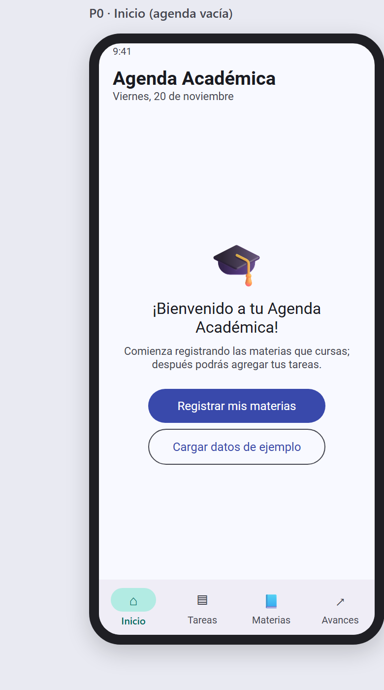{width=135}<br>**P0** Bienvenida | 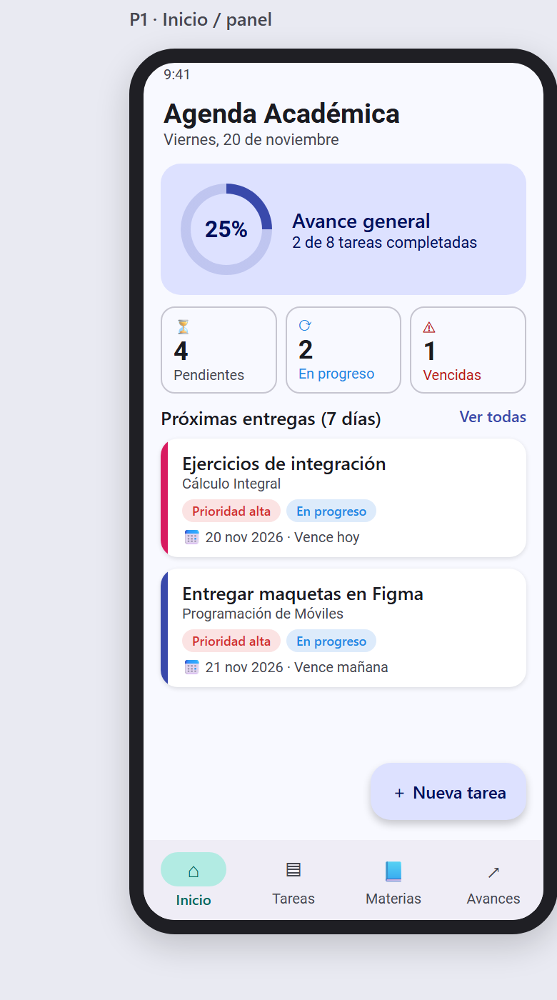{width=135}<br>**P1** Inicio | 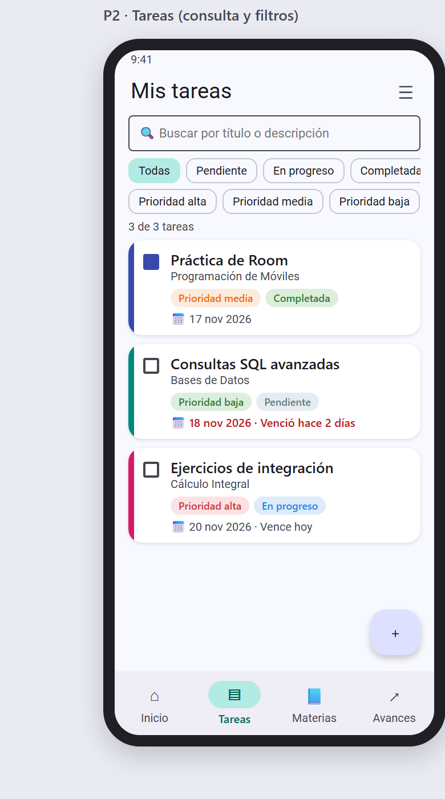{width=135}<br>**P2** Tareas | 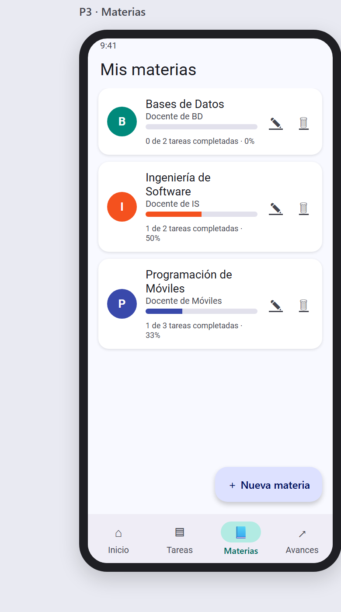{width=135}<br>**P3** Materias |
| 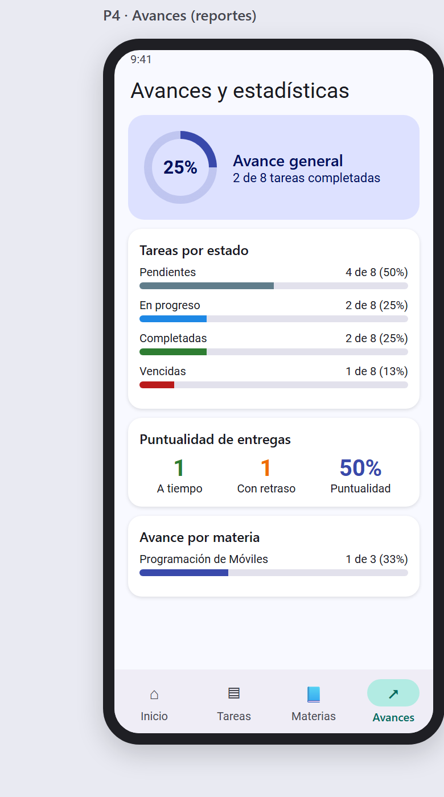{width=135}<br>**P4** Avances | 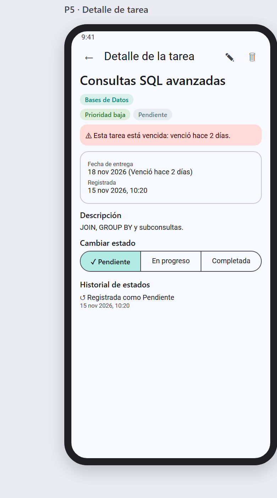{width=135}<br>**P5** Detalle | 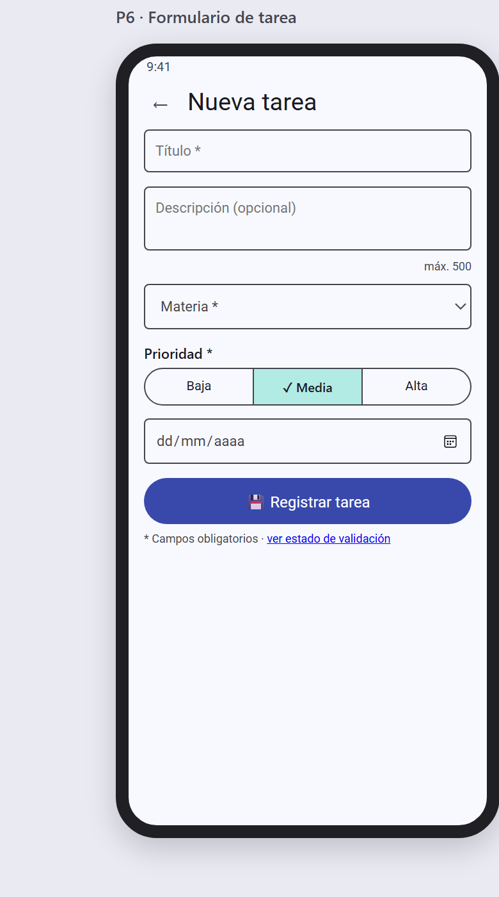{width=135}<br>**P6** Formulario | 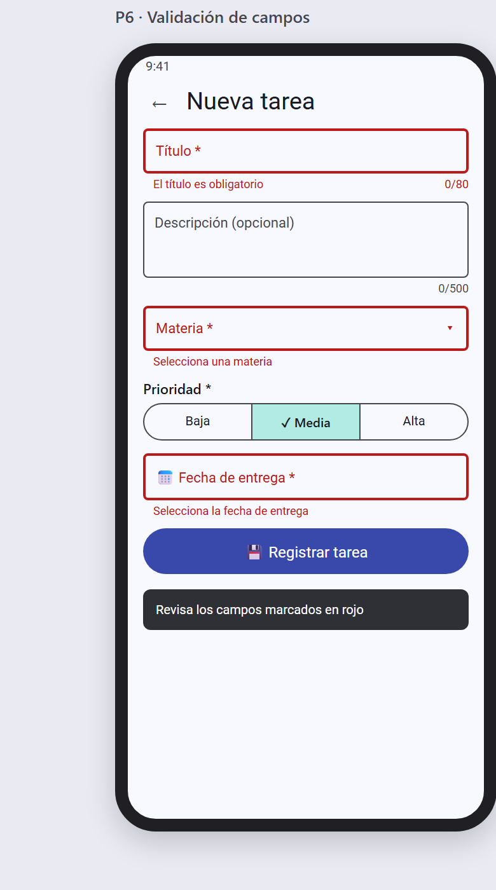{width=135}<br>**P6** Validación |
| 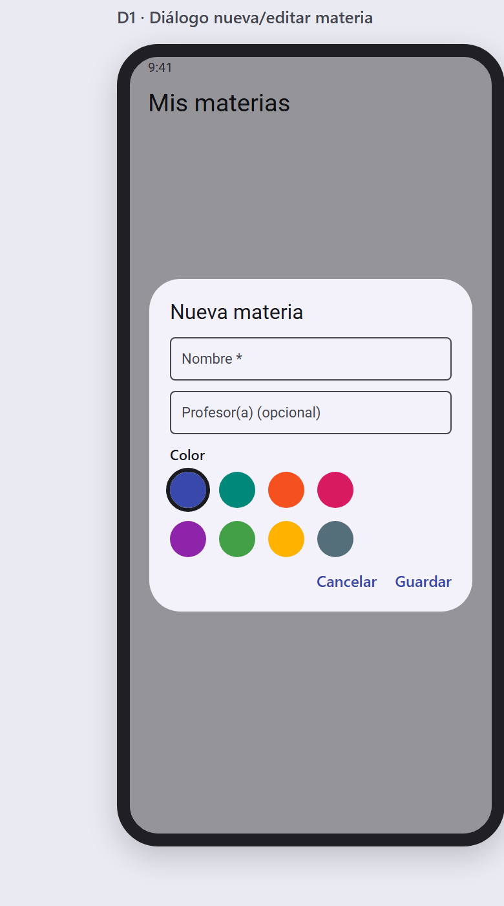{width=135}<br>**D1** Diálogo de materia | 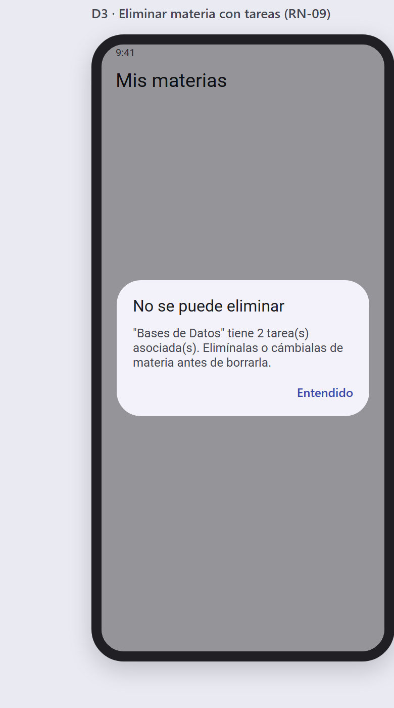{width=135}<br>**D3** Eliminar materia | | |

#### Guía de estilo (colores, tipografía, componentes y flujo)

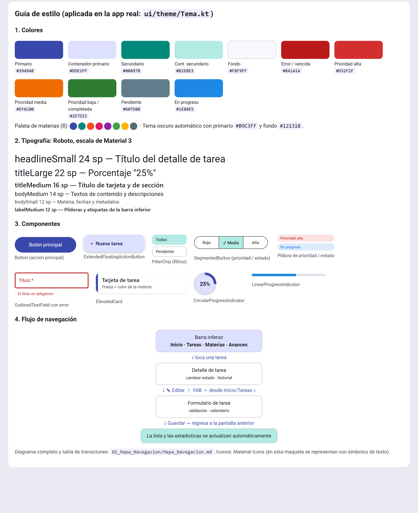{width=600}

## 2. Pantallas maquetadas

| ID | Pantalla | Operación principal que prototipa |
|---|---|---|
| P0 | Inicio con la agenda vacía | Primer uso: registrar materias o cargar los datos de ejemplo |
| P1 | Inicio / panel | Consultar el avance general, las próximas entregas y las vencidas |
| P2 | Tareas | Buscar, filtrar por estado/prioridad/materia, completar con la casilla |
| P3 | Materias | Consultar el avance por materia; editar y eliminar |
| P4 | Avances | Reportes por estado, puntualidad, prioridad y materia |
| P5 | Detalle de tarea | Cambiar el estado y ver el historial; editar y eliminar |
| P6 | Formulario de tarea | Registrar una tarea (y la variante con los errores de validación) |
| D1 | Diálogo de materia | Alta y edición de materia con selector de color |
| D3 | Diálogo de eliminación | Regla RN-09: no se elimina una materia con tareas |

**Flujos que se pueden recorrer en el prototipo:**
1. P0 → *Registrar mis materias* → P3 → *Nueva materia* → D1 → *Guardar* → P3.
2. P1 → *Nueva tarea* → P6 → *Registrar tarea* (vacío) → P6 con validación → *Registrar tarea* → P2.
3. P2 → tarjeta → P5 → ✎ → P6.
4. Barra inferior entre P1, P2, P3 y P4.

## 3. Distribución de componentes (patrón común)

```
┌────────────────────────────┐
│ Barra superior (título,    │  TopAppBar: título + subtítulo o acciones (ordenar, editar, eliminar)
│ acciones)                  │
├────────────────────────────┤
│ Contenido desplazable      │  LazyColumn de tarjetas / formulario con scroll
│  · Tarjetas con franja de  │  La franja izquierda usa el color de la materia
│    color de materia        │  Píldoras: prioridad (rojo/naranja/verde) y estado
│  · Píldoras de prioridad   │
│    y estado                │
│                     [FAB]  │  Botón flotante: acción principal de la pantalla
├────────────────────────────┤
│ Inicio Tareas Materias Av. │  NavigationBar (menú principal, 4 destinos)
└────────────────────────────┘
```

- **Formularios:** etiqueta con `*` en los campos obligatorios, contador de caracteres y mensaje de error debajo de cada campo (rojo). Para opciones cerradas (prioridad, estado) se usan **botones segmentados**; para la materia, un menú desplegable; para la fecha, un **calendario** (DatePicker).
- **Acciones destructivas:** siempre llevan un diálogo de confirmación, con el botón *Eliminar* en color de error.
- **Retroalimentación:** Snackbar al guardar o al cargar datos, y estados vacíos con ilustración, mensaje y acción.

## 4. Colores, tipografía e iconografía

| Rol | Color (claro) | Color (oscuro) | Uso |
|---|---|---|---|
| Primario | `#3949AB` índigo | `#B9C3FF` | Botones principales, anillo de avance, enlaces |
| Contenedor primario | `#DDE1FF` | `#2B3EA0` | Tarjeta de avance general, FAB |
| Secundario (contenedor) | `#B2EBE3` | `#005048` | Indicador de la pestaña seleccionada y chips activos |
| Fondo / superficie | `#F8F9FF` | `#121318` | Fondo de las pantallas |
| Error | `#BA1A1A` | `#FFB4AB` | Validación, tareas vencidas, eliminar |
| Prioridad alta / media / baja | `#D32F2F` / `#EF6C00` / `#2E7D32` | iguales | Píldoras de prioridad |
| Estado pendiente / en progreso / completada | `#607D8B` / `#1E88E5` / `#2E7D32` | iguales | Píldoras de estado y barras |
| Paleta de materias (8) | `#3949AB #00897B #F4511E #D81B60 #8E24AA #43A047 #FFB300 #546E7A` | iguales | Franja, círculo y barra de cada materia |

- **Tipografía:** Roboto, con la escala de Material 3 (`headlineSmall` para los títulos de detalle, `titleMedium` para los títulos de tarjeta y `bodySmall`/`labelMedium` para los metadatos).
- **Iconografía:** Material Icons (Extended).
  - Barra inferior: `Home`, `Assignment`, `MenuBook`, `Insights`.
  - Acciones: `Add`, `Edit`, `Delete`, `Sort`, `Search`, `Event`, `History`, `Warning`.
  - Icono de la app: *assignment turned in* sobre índigo (icono adaptativo).
- El color nunca es la única señal: cada píldora lleva texto ("Prioridad alta", "Vencida…") por accesibilidad.

## 5. Cómo se trasladaron las maquetas al desarrollo

| Maqueta | Implementación (archivo) | Captura real |
|---|---|---|
| P0 / P1 | `ui/inicio/Inicio.kt` | `01_inicio_vacio.png`, `02_inicio_panel.png`, `03_inicio_vencidas.png`, `17_inicio_tema_oscuro.png` |
| P2 | `ui/tareas/Tareas.kt` | `04_tareas_lista.png`, `05_tareas_filtro_alta.png` |
| P3, D1, D3 | `ui/materias/Materias.kt` | `06_materias.png`, `15_dialogo_materia.png`, `16_no_se_puede_eliminar.png` |
| P4 | `ui/avances/Avances.kt` | `07_avances.png`, `08_avances_materia.png` |
| P5 | `ui/detalle/DetalleTarea.kt` | `09_detalle_completada.png`, `10_detalle_historial.png`, `11_detalle_vencida.png` |
| P6 | `ui/formulario/FormularioTarea.kt` | `12_formulario_vacio.png`, `13_formulario_validacion.png`, `14_calendario.png` |
| Guía de estilo | `ui/theme/Tema.kt`, `ui/componentes/Componentes.kt` | — |

**Diferencias entre la maqueta y la app:** la app agrega el tema oscuro automático, el menú *Ordenar por* y el calendario nativo de Material 3. En la maqueta, los iconos se representan con símbolos de texto.
