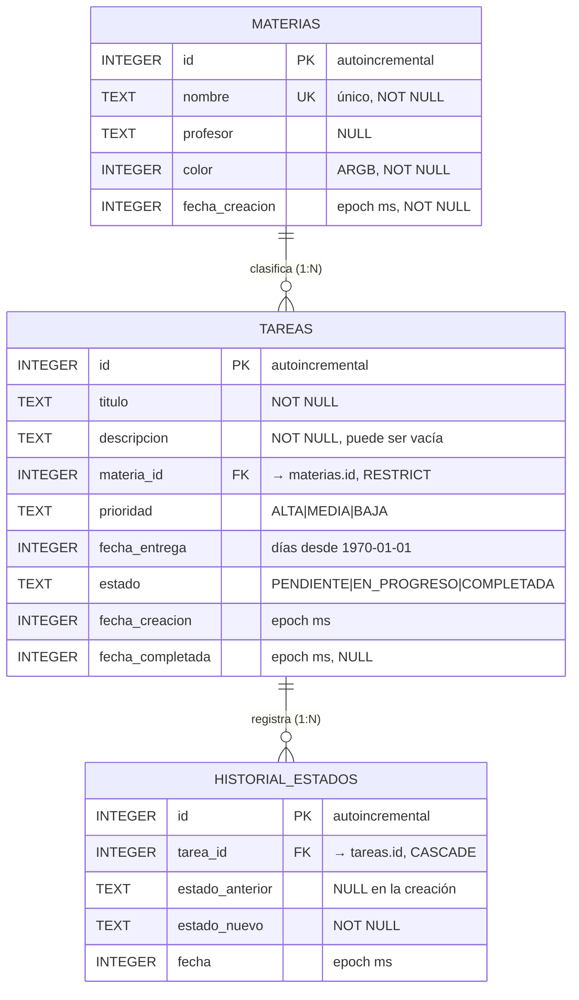

# Entregable 4 — Modelo de datos

**Aplicación:** Agenda Académica · **Equipo 1**
**Tecnología:** Room 2.8 sobre SQLite (base local `agenda_academica.db`, versión de esquema 1).
El esquema real generado por Room está en `app-android/app/schemas/com.equipo1.agendaacademica.data.local.AgendaDatabase/1.json` (es evidencia de que el modelo coincide con la implementación).

## 1. Diagrama entidad-relación



## 2. Entidades, llaves y relaciones

| Entidad | Descripción | PK | FK | Índices |
|---|---|---|---|---|
| `materias` | Asignaturas que cursa el estudiante | `id` | — | `nombre` (UNIQUE) |
| `tareas` | Tareas o actividades académicas | `id` | `materia_id` → `materias.id` (ON DELETE **RESTRICT**, ON UPDATE CASCADE) | `materia_id`, `fecha_entrega`, `estado` |
| `historial_estados` | Bitácora de cambios de estado de cada tarea | `id` | `tarea_id` → `tareas.id` (ON DELETE **CASCADE**) | `tarea_id` |

**Relaciones:**
- **materias 1 : N tareas.** Una materia agrupa cero o muchas tareas; cada tarea pertenece a exactamente una materia (obligatoria). Se usa RESTRICT para que no queden tareas huérfanas (RN-09).
- **tareas 1 : N historial_estados.** Cada tarea tiene uno o más registros (al menos el de su creación). Se usa CASCADE porque el historial no tiene sentido sin su tarea.

**Normalización:** el modelo está en 3FN.
- La materia no se repite dentro de la tarea (solo se guarda su `materia_id`).
- Los valores calculados (vencida, porcentaje de avance, días restantes, puntualidad) **no se almacenan**: se derivan en `CalculadoraAvance` y así se evitan inconsistencias.

## 3. Diccionario de datos

### Tabla `materias`
| Campo | Tipo SQLite | Tipo Kotlin | Nulo | Restricciones | Descripción |
|---|---|---|---|---|---|
| id | INTEGER | Long | No | PK, AUTOINCREMENT | Identificador único |
| nombre | TEXT | String | No | UNIQUE; 2–50 caracteres; único sin distinguir mayúsculas (validado por el repositorio con `COLLATE NOCASE`) | Nombre de la materia |
| profesor | TEXT | String? | Sí | ≤ 60 caracteres | Nombre del docente (opcional) |
| color | INTEGER | Int | No | Uno de los 8 colores de `PaletaMaterias` | Color ARGB que identifica la materia en la interfaz |
| fecha_creacion | INTEGER | Long | No | — | Momento de registro (milisegundos desde 1970, UTC) |

### Tabla `tareas`
| Campo | Tipo SQLite | Tipo Kotlin | Nulo | Restricciones | Descripción |
|---|---|---|---|---|---|
| id | INTEGER | Long | No | PK, AUTOINCREMENT | Identificador único |
| titulo | TEXT | String | No | 3–80 caracteres (RN-01) | Título corto |
| descripcion | TEXT | String | No | 0–500 caracteres (RN-02); cadena vacía si no hay | Detalle de la actividad |
| materia_id | INTEGER | Long | No | FK → materias.id RESTRICT | Materia a la que pertenece |
| prioridad | TEXT | `Prioridad` (enum) | No | `ALTA`, `MEDIA`, `BAJA` | Urgencia o importancia |
| fecha_entrega | INTEGER | `LocalDate` | No | ≥ hoy al crear (RN-04) | Día de entrega, guardado como número de días desde 1970-01-01 (sin zona horaria) |
| estado | TEXT | `EstadoTarea` (enum) | No | `PENDIENTE`, `EN_PROGRESO`, `COMPLETADA`; inicia en `PENDIENTE` | Estado actual |
| fecha_creacion | INTEGER | Long | No | — | Momento de registro (ms) |
| fecha_completada | INTEGER | Long? | Sí | Solo si estado = `COMPLETADA` (RN-06) | Momento en que se completó (ms) |

### Tabla `historial_estados`
| Campo | Tipo SQLite | Tipo Kotlin | Nulo | Restricciones | Descripción |
|---|---|---|---|---|---|
| id | INTEGER | Long | No | PK, AUTOINCREMENT | Identificador |
| tarea_id | INTEGER | Long | No | FK → tareas.id CASCADE | Tarea a la que pertenece |
| estado_anterior | TEXT | EstadoTarea? | Sí | `NULL` en el registro de creación | Estado antes del cambio |
| estado_nuevo | TEXT | EstadoTarea | No | — | Estado después del cambio |
| fecha | INTEGER | Long | No | — | Momento del cambio (ms) |

**Conversión de tipos** (`data/local/Convertidores.kt`): `LocalDate` ↔ `Long` (`toEpochDay`) y los enums ↔ `String` (`name`/`valueOf`). Guardar los enums como texto hace que la base sea legible al inspeccionarla con *App Inspection* de Android Studio.

## 4. Justificación de la tecnología de almacenamiento

| Opción evaluada | Ventajas | Desventajas | Decisión |
|---|---|---|---|
| **Room (SQLite local)** | Biblioteca oficial de Android Jetpack; modelo relacional con PK/FK reales; consultas SQL verificadas al compilar; integración con Kotlin Flow (la interfaz se actualiza sola); funciona sin Internet; sin costo | Los datos no se sincronizan entre dispositivos | ✅ **Elegida** |
| Firebase Firestore | Sincronización en la nube y multiusuario | Requiere cuenta de Google, conexión e infraestructura externa; modelo NoSQL (no permite mostrar FK reales en el diagrama ER); no hace falta para una app personal | ❌ |
| DataStore / SharedPreferences | Muy simple | Solo sirve para pares clave-valor (preferencias), no para datos relacionales | ❌ |
| Archivos JSON | Sin dependencias | Sin consultas, sin integridad y con riesgo de corrupción | ❌ |

El problema del Equipo 1 es **personal** (un estudiante y sus tareas), así que una base local cubre el requerimiento con la menor complejidad y la mejor privacidad (RNF-02, RNF-08).

## 5. Cómo se almacenan, consultan, modifican y eliminan los datos

Flujo de capas (MVVM + Repository):

```
Pantalla (Compose) → ViewModel → RepositorioAcademico → DAO (Room) → SQLite
        ↑                                                            │
        └──────────── Flow<List<…>> (actualización automática) ──────┘
```

| Operación | Ejemplo en la app | Implementación |
|---|---|---|
| **Crear (INSERT)** | Registrar tarea | `RepositorioAcademico.crearTarea` → `TareaDao.insertarConHistorial` (`@Transaction`: inserta la tarea y el registro inicial del historial de forma atómica) |
| **Consultar (SELECT)** | Lista de tareas con su materia | `@Transaction @Query("SELECT * FROM tareas ORDER BY fecha_entrega")` devolviendo `Flow<List<TareaConMateria>>` (`@Relation` carga la materia) |
| **Consultar con agregados** | Avance por materia | `SELECT m.*, COUNT(t.id) AS total, SUM(CASE WHEN t.estado='COMPLETADA' …) AS completadas FROM materias m LEFT JOIN tareas t … GROUP BY m.id` |
| **Modificar (UPDATE)** | Cambiar estado o editar | `TareaDao.actualizarConHistorial` (`@Transaction`: `@Update` + inserción en el historial si cambió el estado) |
| **Eliminar (DELETE)** | Eliminar tarea | `@Delete`; SQLite borra el historial en cascada |
| **Eliminar con restricción** | Eliminar materia | El repositorio cuenta las tareas asociadas y rechaza la operación con un mensaje; si se intentara directamente, SQLite lanza `SQLiteConstraintException` (verificado en la prueba `llaveForaneaRestrict…`) |

- **Hilos:** todas las operaciones son `suspend` o `Flow`, así que Room las ejecuta fuera del hilo principal y la interfaz nunca se bloquea.
- **Filtros y búsqueda:** se aplican en memoria sobre la lista observada (`FiltroTareas.aplicar`). El volumen de datos de un estudiante (cientos de tareas) lo permite y la lógica queda en una función pura con pruebas unitarias.
