# Anexo — Capturas reales de la aplicación

Capturas tomadas por Claude Code con `adb exec-out screencap -p` de la app **Agenda Académica v1.0** ejecutándose en el emulador Android "Pixel_6" (API 37, 1080 × 2400 px). No están editadas. El emulador usa la zona horaria UTC, por eso la fecha mostrada es el 21 de noviembre de 2026.

Las capturas 03 y 08 se tomaron después de desplazar la pantalla hacia abajo con un deslizamiento.

| | | |
|---|---|---|
| 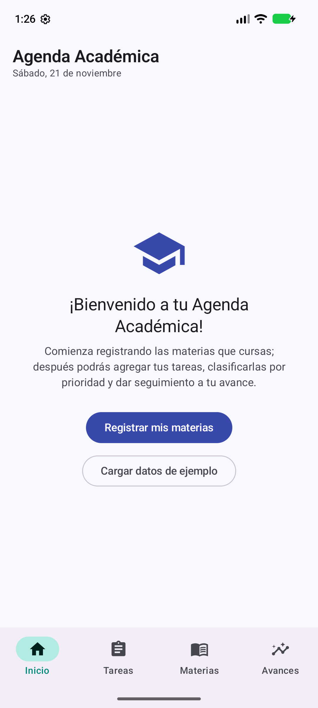{width=170} **01** Inicio con la agenda vacía (P0) | 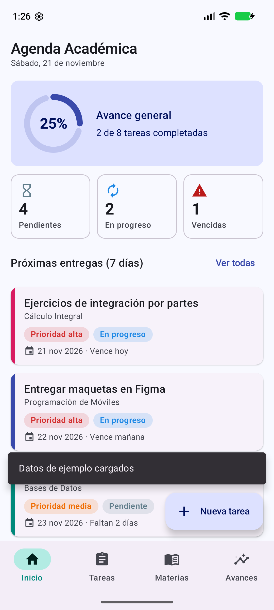{width=170} **02** Panel de inicio tras cargar los datos de ejemplo | 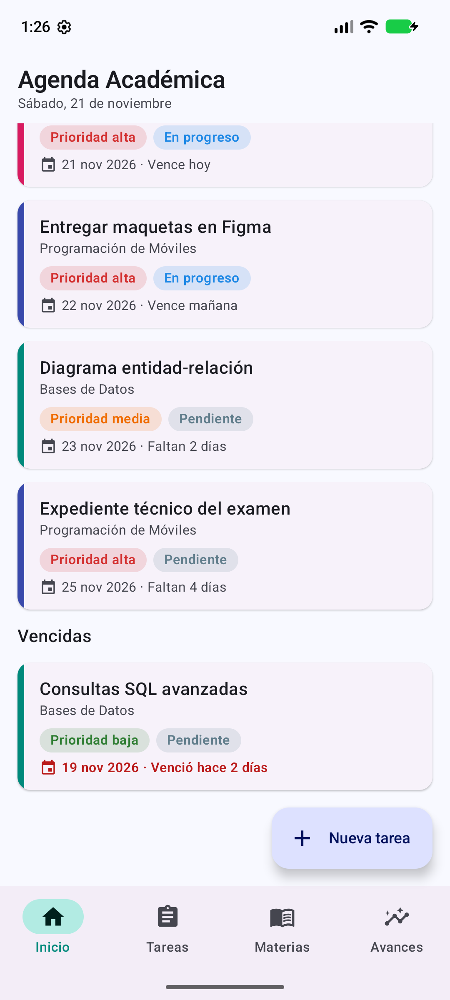{width=170} **03** Inicio: próximas entregas y vencidas |
| 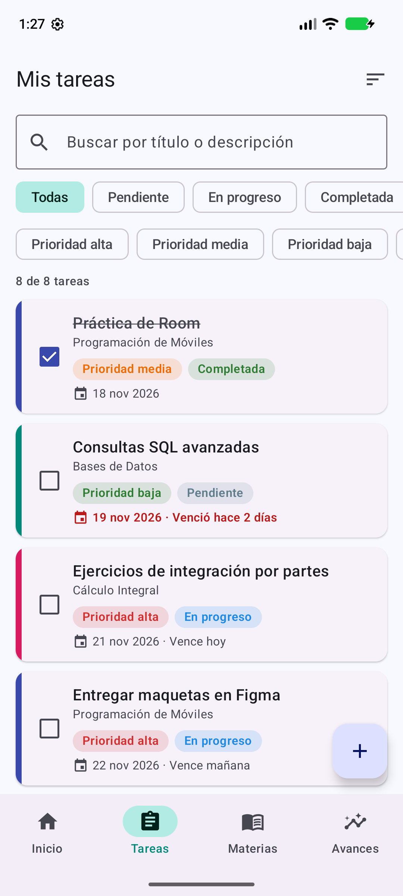{width=170} **04** Lista de tareas con filtros | 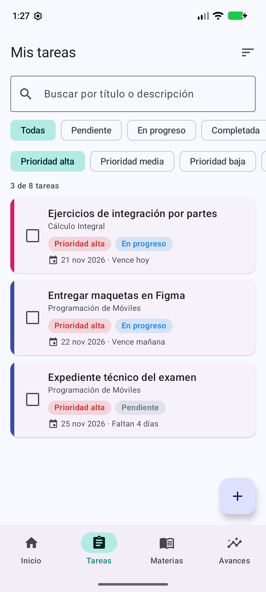{width=170} **05** Filtro "Prioridad alta" | 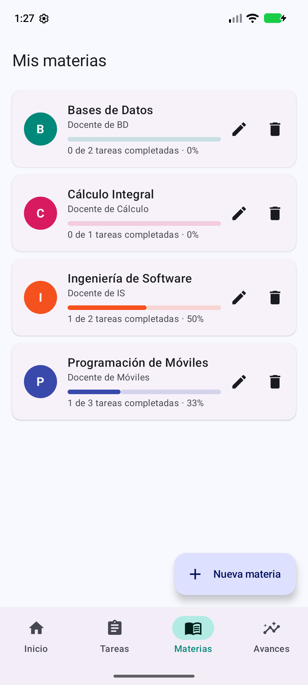{width=170} **06** Materias con su avance |
| 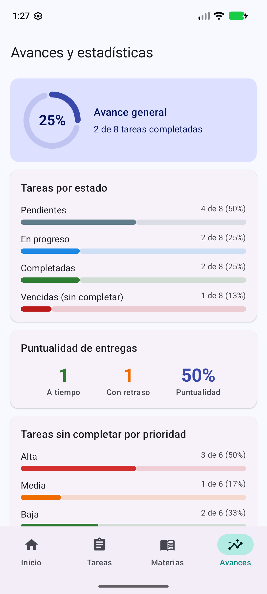{width=170} **07** Avances y estadísticas | 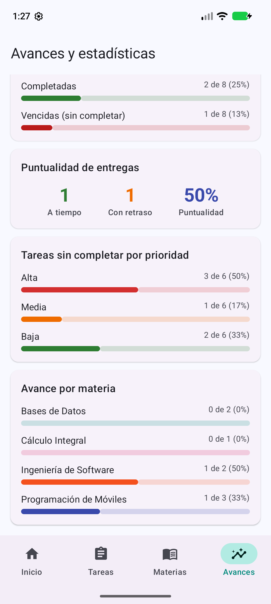{width=170} **08** Avances: por prioridad y por materia | 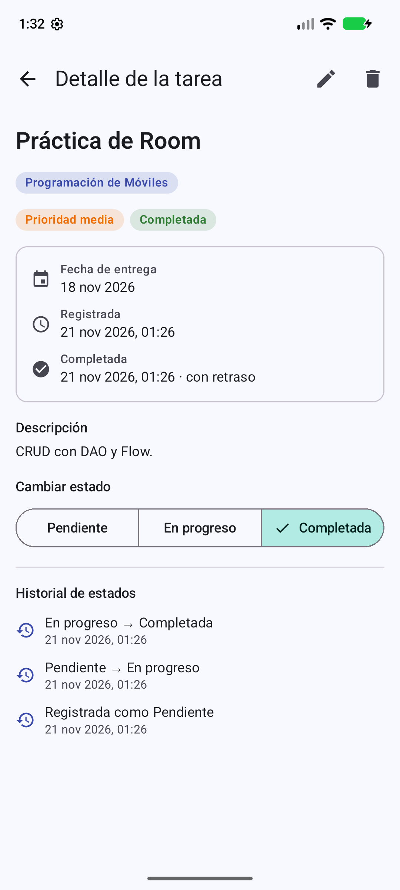{width=170} **09** Detalle de una tarea completada (con retraso) |
| {width=170} **10** Detalle: historial de estados | 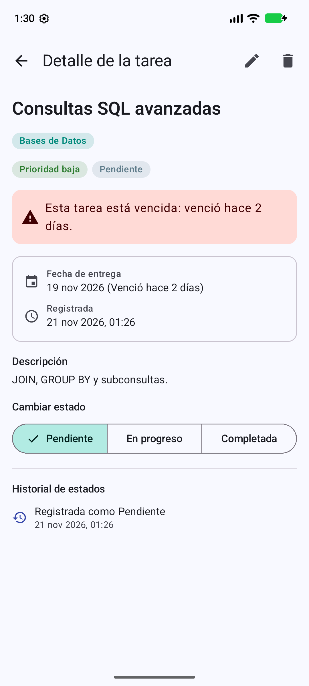{width=170} **11** Detalle de una tarea vencida | 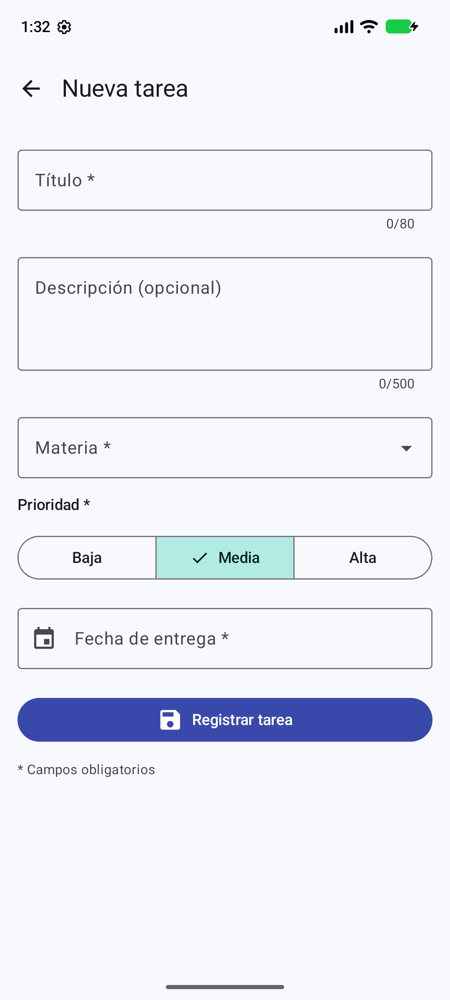{width=170} **12** Formulario de nueva tarea |
| 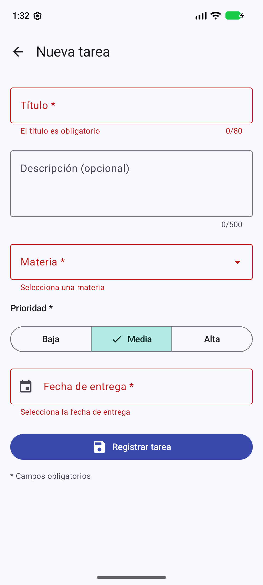{width=170} **13** Validación del formulario (RN-01, 03, 04) | 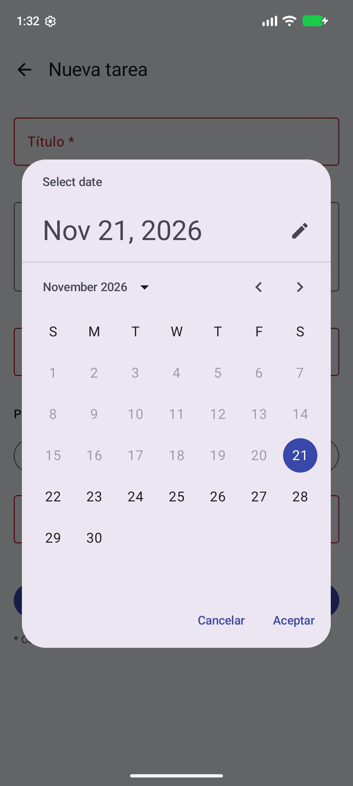{width=170} **14** Calendario con los días pasados deshabilitados | 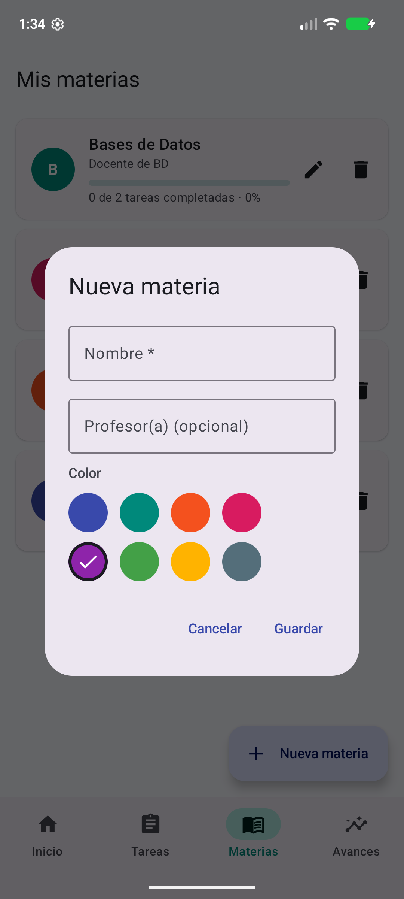{width=170} **15** Diálogo "Nueva materia" con selector de color |
| 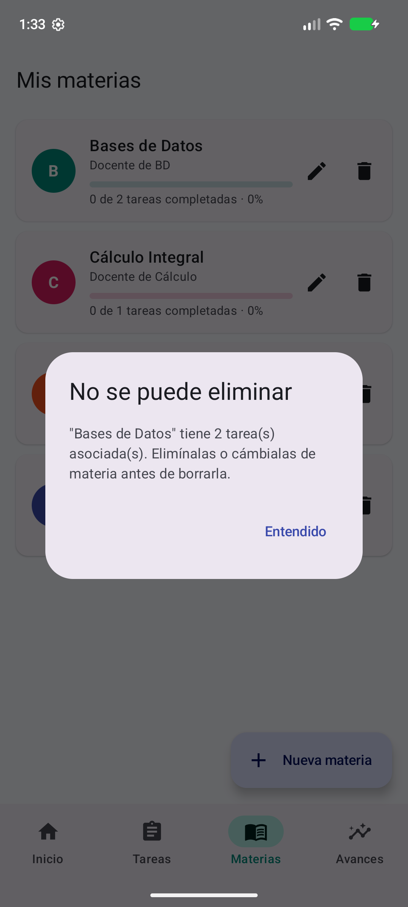{width=170} **16** RN-09: no se puede eliminar una materia con tareas | 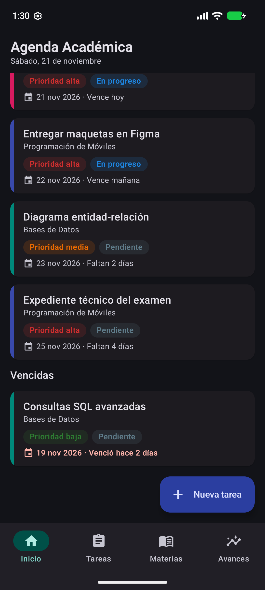{width=170} **17** Tema oscuro | 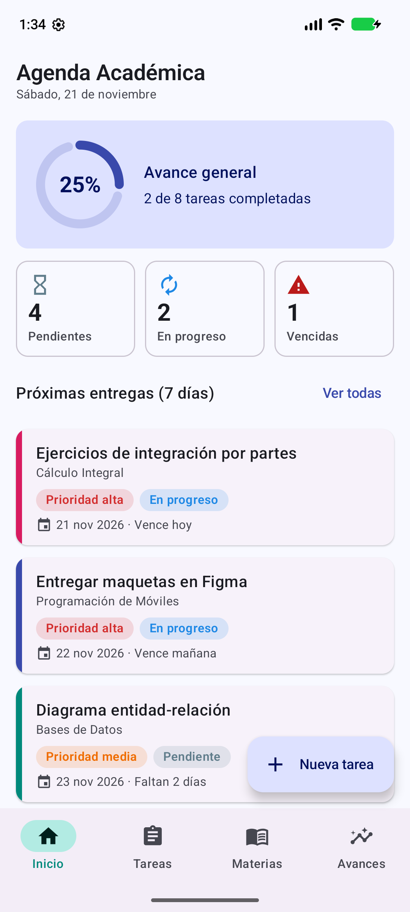{width=170} **18** Datos conservados tras detener el proceso de la app |
| 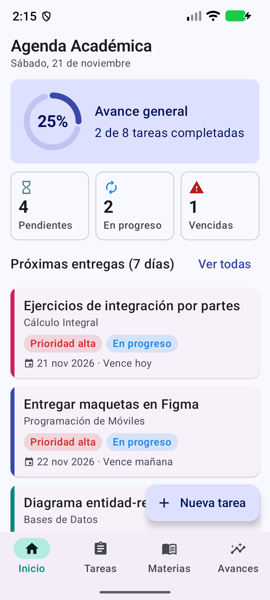{width=170} **20** Compatibilidad C-6: fuente del sistema al 130 %, Inicio | 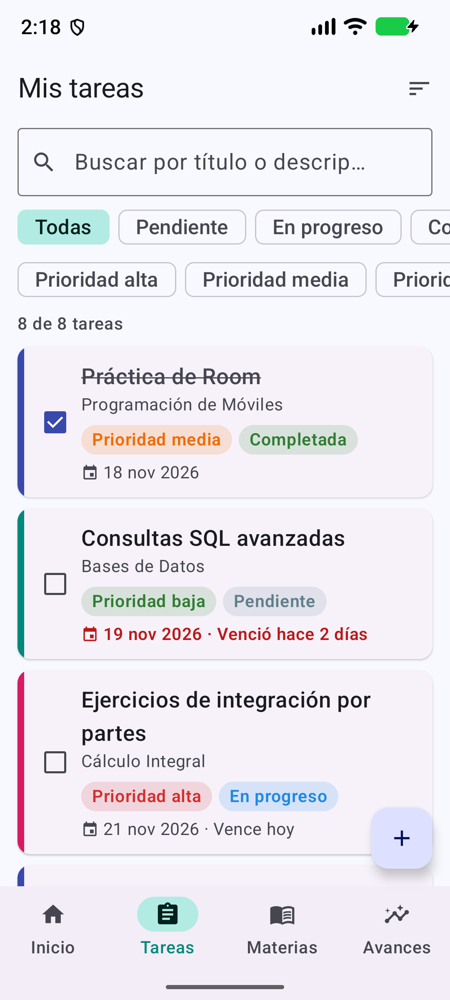{width=170} **21** C-6: Tareas, con el buscador ya corregido | 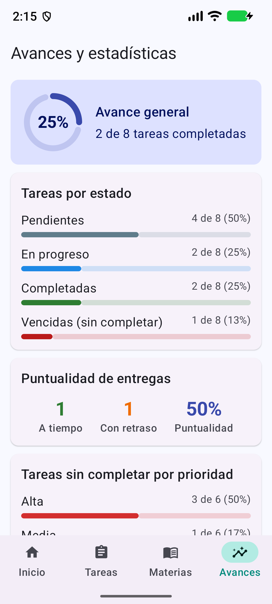{width=170} **22** C-6: Avances |

**Captura 19. Compatibilidad C-5:** rotación a horizontal con el formulario a medio llenar; el texto se conserva.

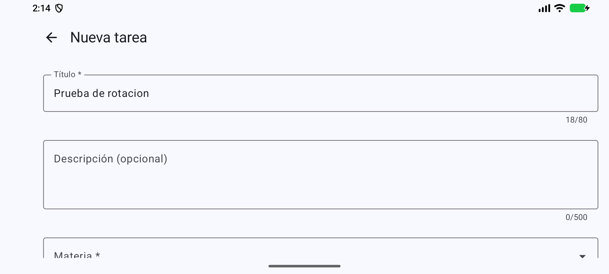{width=520}
